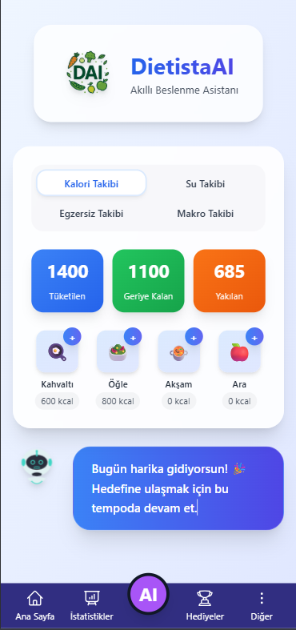
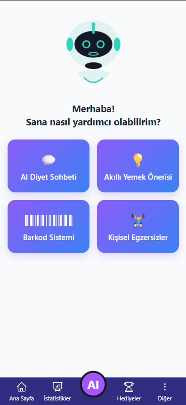
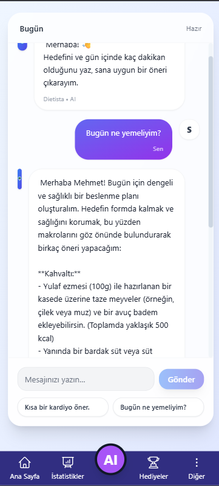
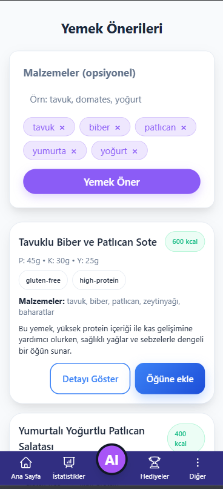
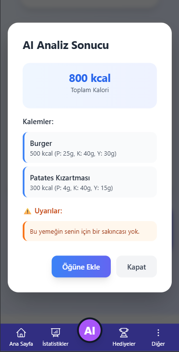
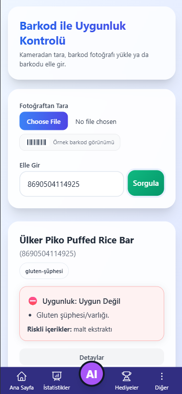
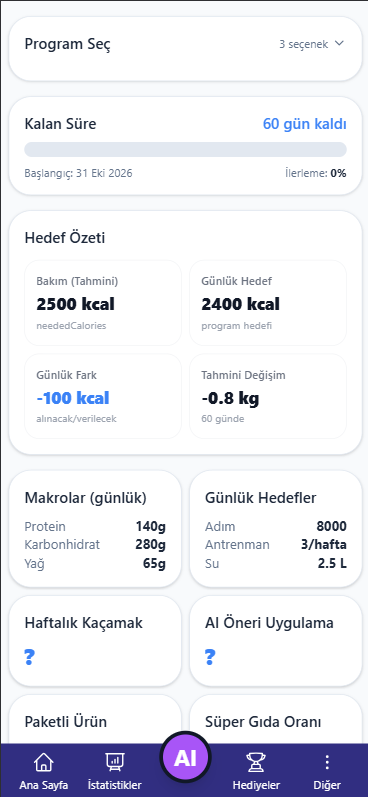
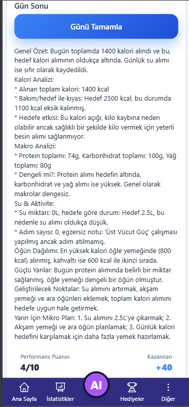
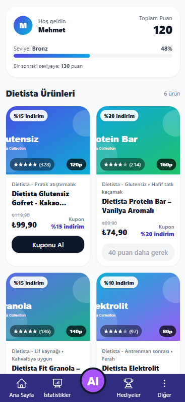

# DietistaAI

**An AI-assisted nutrition and wellness application prototype**

DietistaAI explores how artificial intelligence can support everyday nutrition planning, meal discovery, activity tracking, and personal wellness insights. It combines a Vue.js interface with a Node.js backend that makes AI requests through OpenRouter.

> **Project status:** Prototype / portfolio demonstration. This is not a medical device or a substitute for professional medical or nutritional advice. AI-generated calorie estimates, allergy assessments, and recommendations can be inaccurate.

## Preview

<p align="center">
  
  
  
</p>

## Features

The current prototype includes interfaces and workflows for:

- **Nutrition dashboard:** Daily calorie, meal, hydration, and macro tracking views.
- **AI nutrition chat:** Contextual responses based on a user profile.
- **AI meal suggestions:** Meal ideas based on selected ingredients.
- **Food photo analysis:** AI-generated estimates and ingredient-related warnings.
- **Barcode-based product checks:** Product information lookup using Open Food Facts, with an AI-assisted interpretation workflow.
- **Planning and insights:** Goal summaries, activity and macro targets, and end-of-day reporting.
- **Rewards interface:** Points, progress, and example reward/product cards.

Some functionality uses local/mock data or prototype logic. Features shown in screenshots should not be interpreted as a production-ready service.

## Screenshots

| Dashboard | Meal suggestions | Food analysis |
|:---:|:---:|:---:|
|  |  |  |

| Barcode check | Insights | Daily report |
|:---:|:---:|:---:|
|  |  |  |

<details>
<summary>Rewards screen</summary>


</details>

## Technology stack

| Layer | Technologies |
|---|---|
| Frontend | Vue 2, Vue Router, Vuex, JavaScript, Tailwind CSS |
| Backend | Node.js, Express |
| AI integration | OpenRouter API (server-side) |
| HTTP requests | Axios |
| Barcode data | Open Food Facts API |
| Barcode tooling | ZXing library |

## Project structure

```text
DietistaAI/
├── src/                       # Vue frontend and components
│   ├── api/                   # Frontend API clients
│   ├── components/            # Feature views and UI components
│   ├── router/                # Client-side routes
│   └── store/                 # Vuex state
├── dietista-ai-backend/
│   ├── index.js               # Express server
│   ├── routes/ai.js           # AI endpoints
│   ├── lib/openrouter.js      # Server-side OpenRouter client
│   └── .env.example           # Backend configuration template
├── docs/screenshots/
├── .env.example               # Frontend configuration template
└── package.json
```

## Running locally

### Requirements

- Node.js and npm (use a current compatible Node.js LTS release)
- A valid OpenRouter API key for AI-powered functionality

### 1. Clone and install

```bash
git clone https://github.com/sonersimsekk/DietistaAI-Public.git
cd DietistaAI-Public
npm ci
cd dietista-ai-backend
npm ci
```

### 2. Configure environment variables

In the project root, copy `.env.example` to `.env`:

```dotenv
VUE_APP_API_BASE_URL=http://localhost:3000
```

In `dietista-ai-backend/`, copy `.env.example` to `.env` and set:

```dotenv
OPENROUTER_API_KEY=your_own_key_here
PORT=3000
```

Keep actual keys in local environment files or a secure hosting secret manager. **Never commit `.env` files.** The `VUE_APP_` prefix is for public frontend configuration, not secrets.

### 3. Start the backend

From `dietista-ai-backend/`:

```bash
npm start
```

The API listens on `http://localhost:3000` by default. Health check: `GET /api/health`.

### 4. Start the frontend

From the project root in another terminal:

```bash
npm run serve
```

Open `http://localhost:8080` (or the URL printed by Vue CLI).

AI features require a working backend and valid OpenRouter credentials; non-AI prototype screens may still be browsable without them.

## Security and privacy notes

- OpenRouter credentials are read by the backend through `OPENROUTER_API_KEY`; the frontend uses `VUE_APP_API_BASE_URL` to call the backend.
- The backend includes request size checks and basic rate limiting. **It does not implement full user authentication or production-grade abuse protection.** Do not expose it publicly without adding appropriate authentication, quotas, monitoring, and stricter deployment-specific CORS settings.
- The app may send user-entered profile or wellness information to the AI provider to generate responses. Do not use real sensitive information in a demo without reviewing the provider's data handling and adding suitable privacy protections.
- Product compatibility and allergy-related output is informational and should be independently verified.

## Roadmap

- Improve authentication, privacy controls, and backend abuse prevention
- Replace remaining mock data with a robust persistence layer
- Add automated tests and CI
- Improve accessibility and responsive layouts
- Validate nutrition calculations and strengthen uncertainty messaging
- Improve error handling and deployment documentation

## Author

**Soner Şimşek**

- [GitHub](https://github.com/sonersimsekk)
- [LinkedIn](https://www.linkedin.com/in/soner-şimşek-653357273)

---

*Built as a learning and portfolio project. The application is under development.*
